# Lokal Fırın & Kahve — Misafir Menüsü Tasarım Önizlemesi

Bu belge, aynı ortak menü verisini (`src/data/prototype-menu.ts`) kullanan altı misafir menüsü tasarımını (**Özel Menü**, **Gece**, **Canlı**, **Ferah**, **Klasik QR** ve **Vitrin**) ve yan yana karşılaştırmalarını içerir.

---

## 1. Karşılaştırmalar (`screenshots/karsilastirmalar/`)

### Mobil (`390×844`) — Tüm 6 Tasarım

### Masaüstü (`1440×900`) — Tüm 6 Tasarım

### Mobil (`390×844`) — Klasik QR · Vitrin (Açılış & Ürün Listesi)
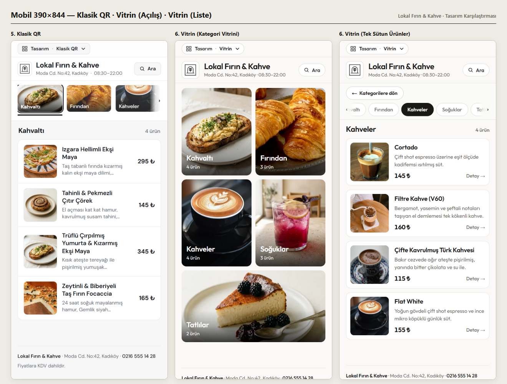

### Önceki Karşılaştırmalar

---

## 2. Tasarım 1: Özel Menü (`screenshots/1-menu-tasarimi-ozel/`)

- Basılı editoryal düzen, sıcak kırık beyaz zemin (`#F6F4EE`), `Barlow Condensed` + `IBM Plex Sans` tipografi, `#2448D8` vurgu ve küçük önizlemeli satır akışı korunmuştur.

### Mobil (`390px` ve `360px`)

### Tasarım Seçici ve Ürün Detayı (Mobil `390px`)

### Masaüstü (`1440px`)

---

## 3. Tasarım 2: Gece (`screenshots/2-menu-tasarimi-gece/`)

- Akşam açık şehir kafesi/restoranı atmosferi: `#171918` sayfa zemini, `#242725` ürün yüzeyleri, `#F5F1E8` ana metin, `#B9BDB6` ikincil metin, `#F28B50` vurgu (turuncu dolgu üzerinde `#171918` koyu metin).
- Başlıklarda `Fraunces`, ürün kartlarında `Plus Jakarta Sans`, mobilde büyük kategori başlıklarında kısa etiket (`Kahvaltı`, `Fırından`, `Kahveler`, `Soğuklar`, `Tatlılar`), yatay kategori şeridinde kenar geçişi ve yön oku işareti (`›` / `‹`), masaüstünde sol sabit dikey gezinme ve tek kategori odaklı gösterim.

### Mobil (`390px` ve `360px`)
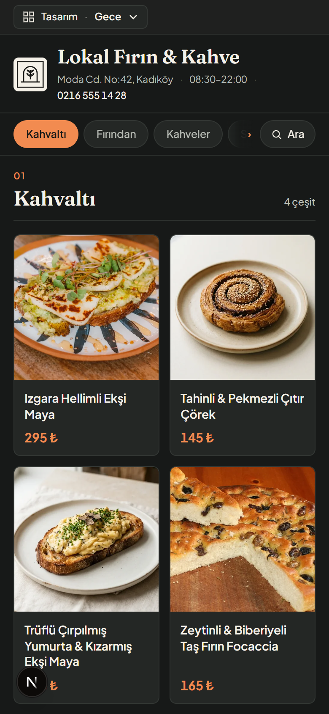

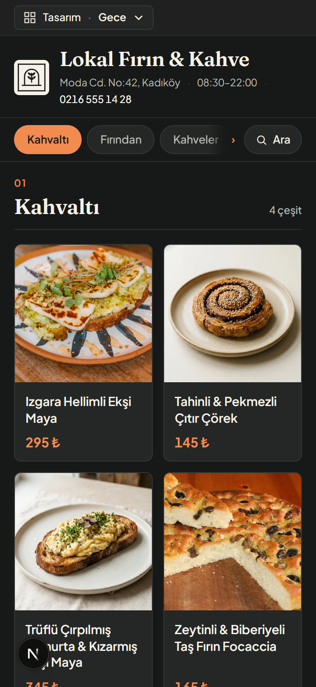

### Tasarım Seçici ve Ürün Detayı (Mobil `390px`)

### Masaüstü (`1440px`)

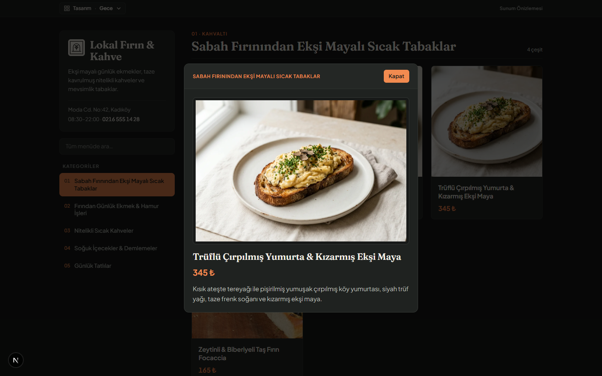

---

## 4. Tasarım 3: Canlı (`screenshots/3-menu-tasarimi-canli/`)

- Neşeli, hareketli ve hızlı servis dostu menü kimliği: `#FFF9ED` açık zemin, `#F4CE45` ana sarı bloklar, `#AD3028` kırmızı seçili durum ve fiyat vurgusu, `#24201B` ana metin ve ölçülü çerçeve çizgileri.
- Başlıklarda `Bricolage Grotesque`, ürün içerikleri ve fiyatlarda `Plus Jakarta Sans` kullanılmıştır.

### Mobil (`390px` ve `360px` — Görselli Kategori Ekranı)
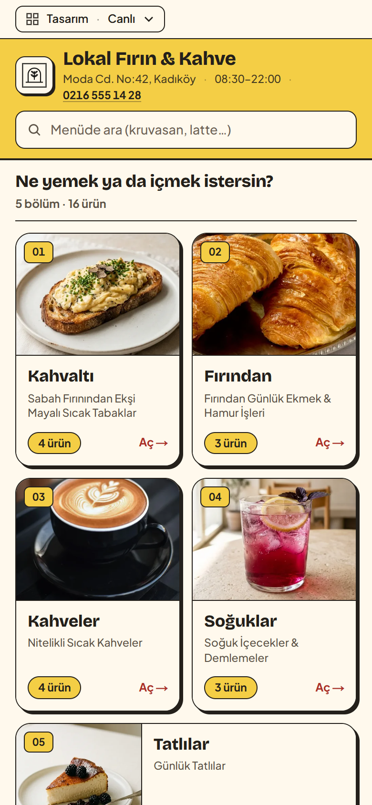

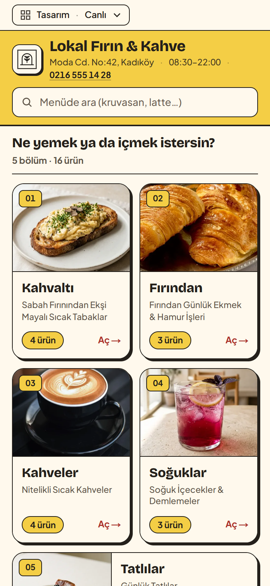

### Mobil (`390px`) — Ürün Listesi, Tasarım Seçici ve Ürün Detayı

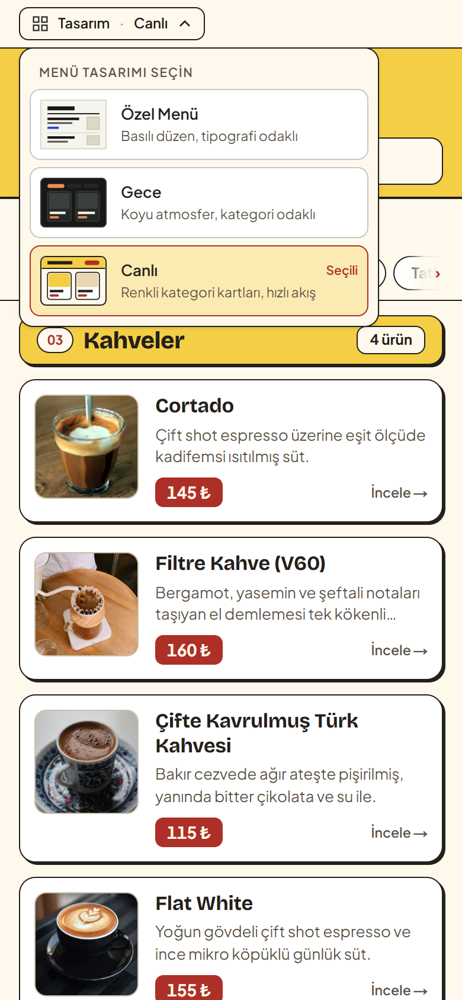

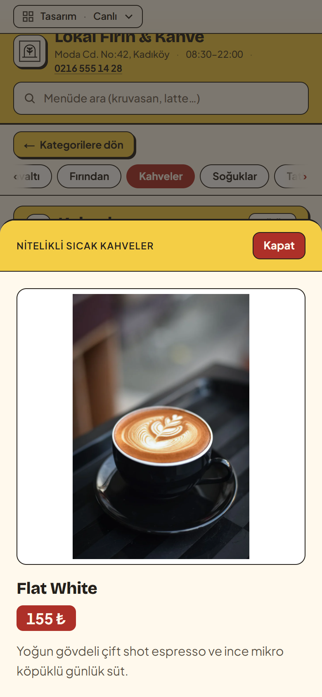

### Masaüstü (`1440px`) — Kategori Ekranı, Ürün Listesi ve Ürün Detayı
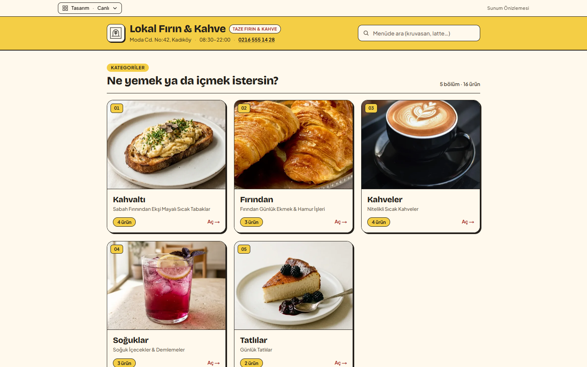

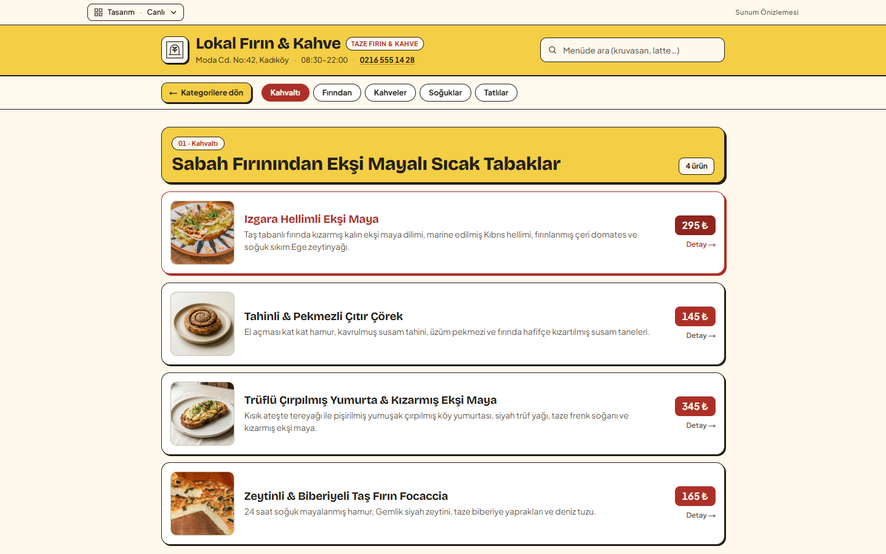

---

## 5. Tasarım 4: Ferah (`screenshots/4-menu-tasarimi-ferah/`)

- Serin, düzenli katalog kimliği: `#FFFFFF` beyaz zemin, `#EFF6FF` açık mavi yüzeyler, `#2454D6` kobalt mavisi vurgu, `#182747` koyu lacivert metin ve `Inter` tipografi.
- Dikey açılır-kapanır kategoriler, birden fazla bölümü açık tutma, *Tümünü aç / Tümünü kapat* kontrolü ve arama sonrası açık bölümleri geri yükleme akışı.

### Mobil (`390px`, `360px` ve Çoklu Açık Bölümler)

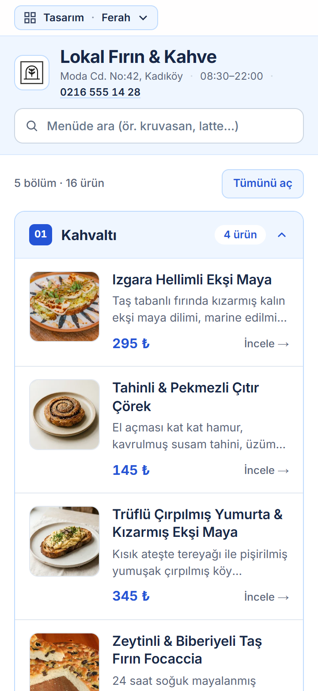

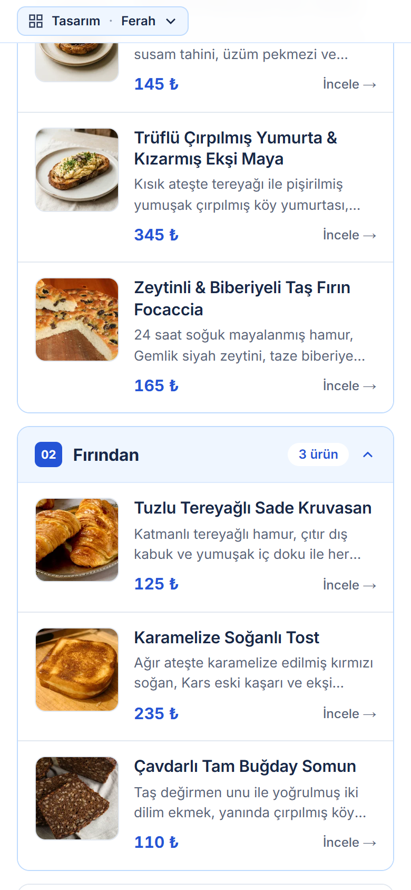

### Tasarım Seçici ve Ürün Detayı (Mobil `390px`)
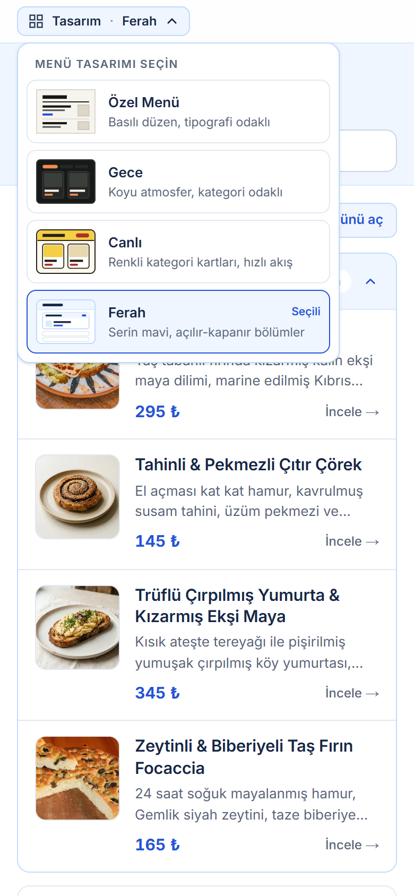

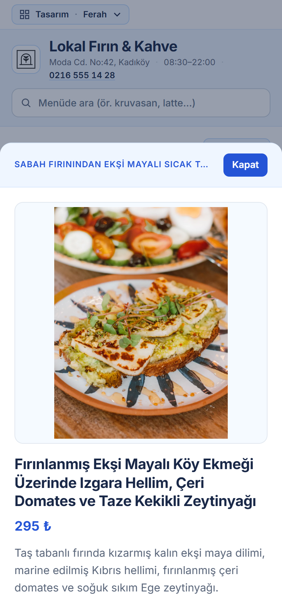

### Masaüstü (`1440px`)

---

## 6. Tasarım 5: Klasik QR (`screenshots/5-menu-tasarimi-klasik/`)

- Açık nötr `#F7F7F8` zemin, saf beyaz ürün satırları, `#1A1D21` ana metin, `#636A73` ikincil metin ve **`DM Sans`** tipografi.
- Kompakt başlık altında yatay kaydırılabilen fotoğraflı kategori şeridi (aktif kategori fotoğraf vurgusu + alt çizgi + başlık satırı ile açıkça işaretlenir).
- İlk ekrandan itibaren görünen kompakt yatay ürün satırlarında solda `84×84 px` (`md: 92 px`) kare fotoğraf, ortada ad ve kısa açıklama, sağda sabit korumalı para birimli fiyat yer alır.

### Mobil (`390px` ve `360px`)

### Tasarım Seçici ve Ürün Detayı (Mobil `390px`)
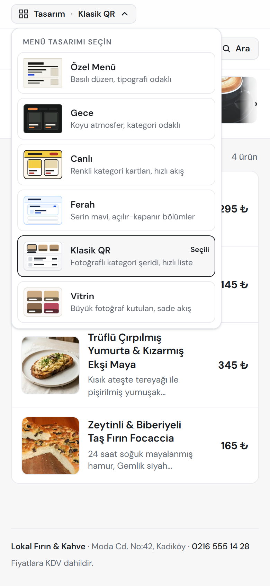

### Masaüstü (`1440px`)

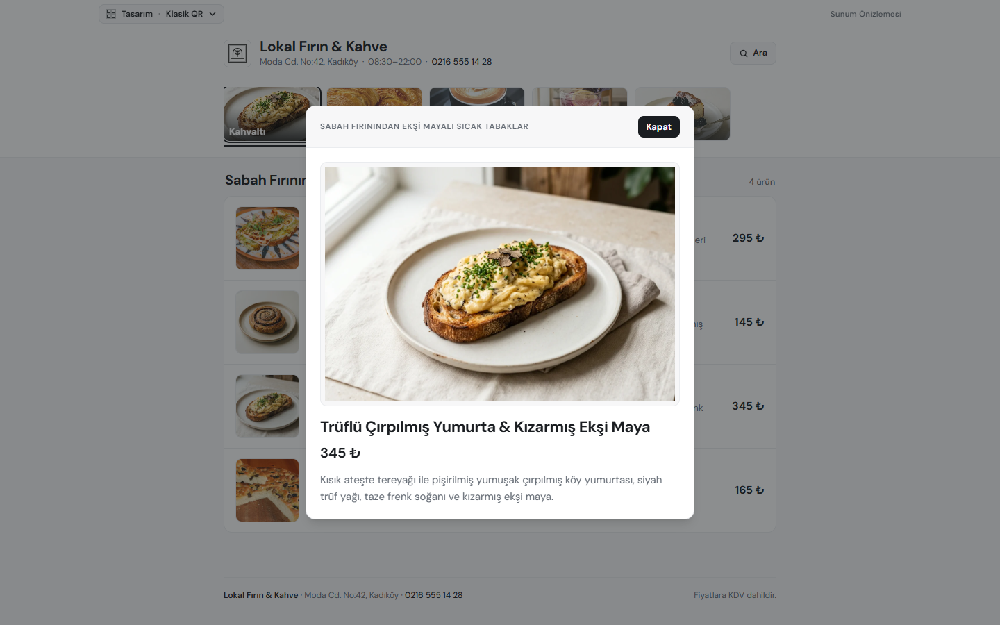

---

## 7. Tasarım 6: Vitrin (`screenshots/6-menu-tasarimi-vitrin/`)

- Sade, fotoğraf ağırlıklı vitrin yaklaşımı: `#FAF9F7` sıcak açık zemin, `#FFFFFF` yüzeyler, `#191817` metin, **`Outfit`** tipografi; numara rozetleri, kalın çerçeveler ve sert gölgeler olmadan.
- Açılışta mobilde 2 sütunlu dar boşluklu, masaüstünde 3 sütunlu geniş fotoğraf kutuları sunulur; kategori adı ve ürün sayısı yalnızca fotoğrafın alt kısmındaki kontrollü koyu geçiş üzerinde yer alır.
- Kategori seçildiğinde **← Kategorilere dön** düğmesi ve yatay kategori geçişi altında **tek sütunlu yatay ürün satırları** açılır: mobilde solda `96×96 px` kare fotoğraf, sağda ad, kısa açıklama ve belirgin fiyat yer alır.

### Mobil (`390px` ve `360px` — Fotoğraflı Kategori Vitrini)
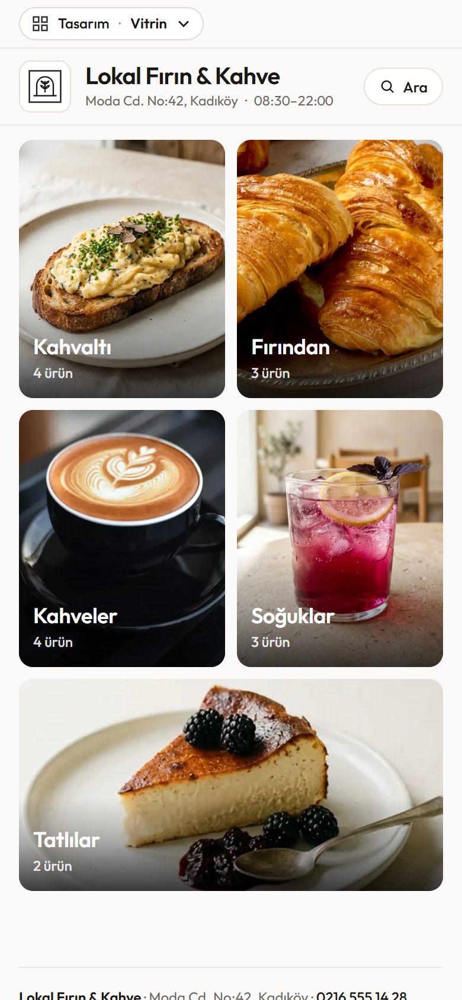

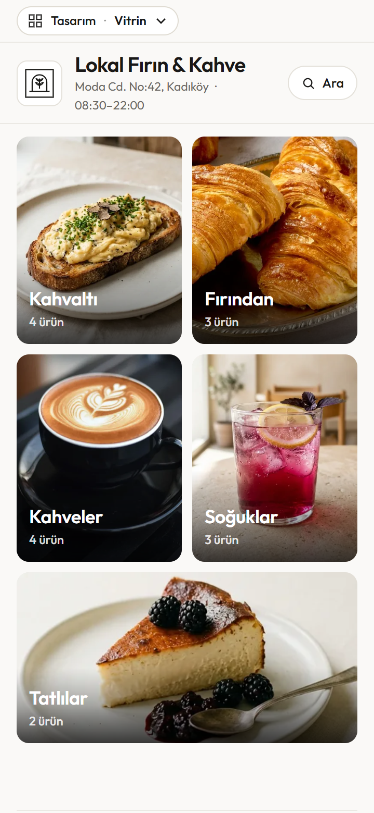

### Mobil (`390px`) — Tek Sütunlu Ürün Listesi, Tasarım Seçici ve Ürün Detayı
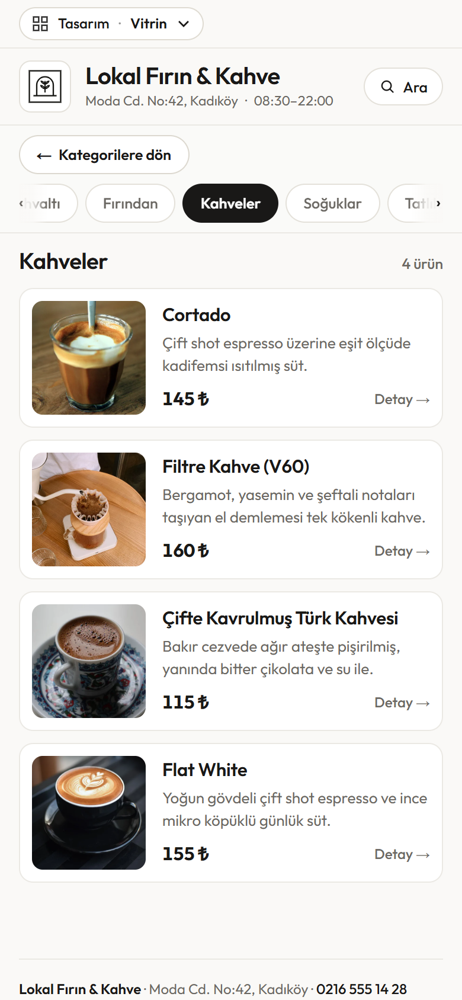

### Masaüstü (`1440px`) — Kategori Vitrini, Ürün Listesi ve Ürün Detayı
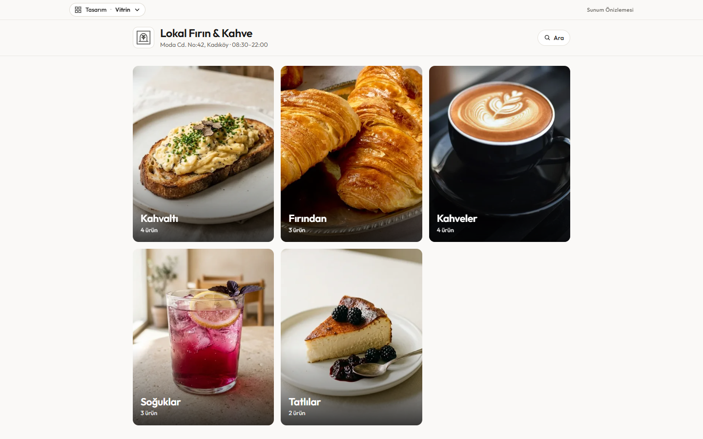

---

## 8. Sunum Paylaşımı, URL Senkronizasyonu ve QR İndirme (`screenshots/sunum-paylasim/`)

- **Doğrudan Tasarım Açılışı ve URL Senkronizasyonu:** Altı tasarımın tamamı `/?tasarim=<id>` (seçici açık sunum bağlantısı) ve `/m/lokal-firin-kahve?tasarim=<id>` (seçici ve paylaşım menüsü gizli müşteri bağlantısı) üzerinden doğrudan açılır; geçersiz `tasarim` değerinde varsayılan **Özel Menü** gösterilir.
- **Kompakt Paylaş Menüsü:** Sunum çubuğundaki kompakt **Paylaş** menüsü *Sunum Bağlantısı* ile *Müşteri Bağlantısı* sekmelerini açıkça ayırır; aktif adres için kopyalama, yeni sekmede açma, canlı SVG/PNG QR üretimi sunar ve `localhost` gibi yerel test adreslerini baskıya hazır çıktı olarak işaretlemez.

### Üst Çubuk ve Paylaşım Menüsü (`390px`, `360px` ve `1440px`)

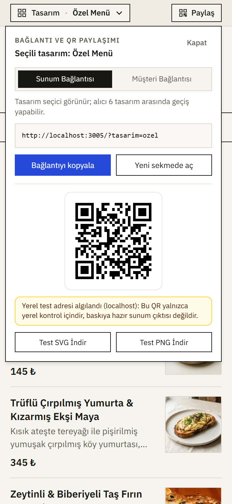

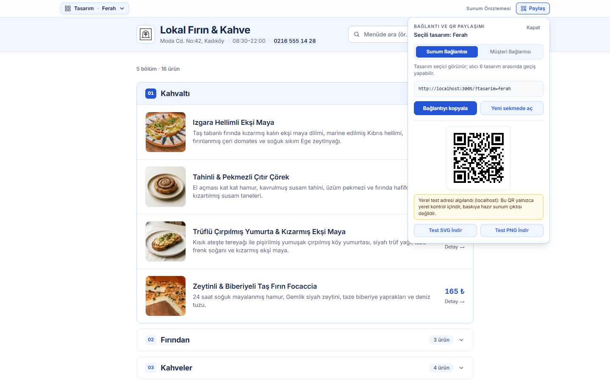
